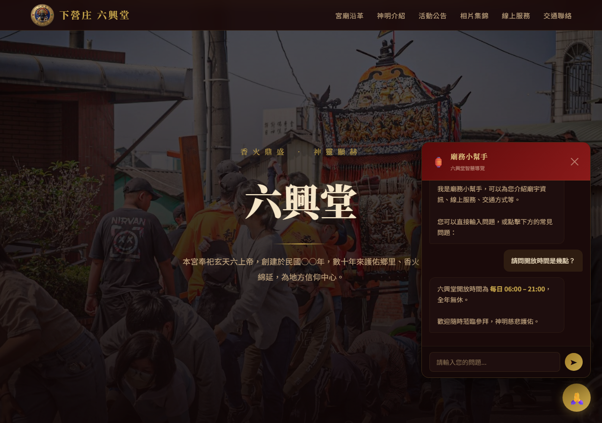
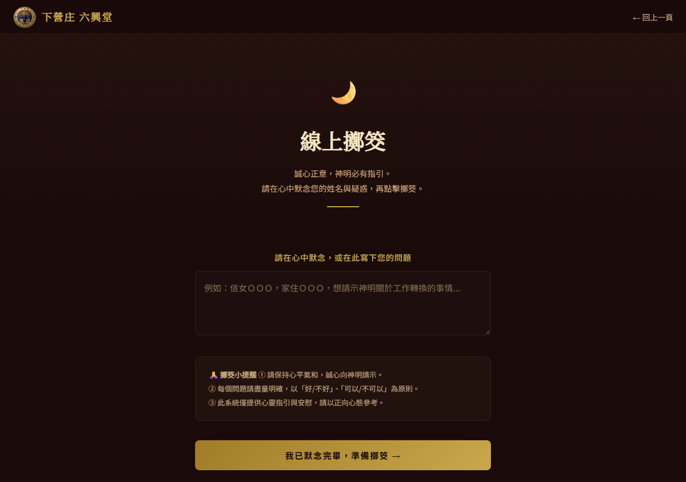
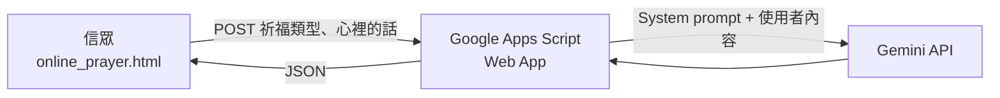

# Temple Website — 下營庄六興堂 官方網站

為臺南市下營區「六興堂」打造的宮廟官方網站。除了介紹宮廟沿革、神明、活動與相片，
也把信眾實際會用到的服務搬到線上：**隨喜捐款、線上祈福、線上擲筊**，並加入一個不需付費 API 的**廟務小幫手**，
以及由 Gemini 生成、針對祈願內容給予回應的**祈福回應**。

**線上版：** [ping-hsun-chiang.github.io/temple-website](https://ping-hsun-chiang.github.io/temple-website/)




---

## 要解決的問題

地方宮廟的資訊多半只存在於長輩的記憶、廟裡的看板和 Facebook 粉專貼文裡：

- **資訊分散：** 地址、開放時間、神明典故、活動消息，外地信眾或年輕一代很難一次找齊。
- **服務只能到現場：** 添油香、祈福、擲筊都要親自到廟裡，住在外地的信眾無法參與。
- **廟方人力有限：** 常見問題（在哪裡、幾點開、怎麼捐款）一再重複，卻沒有人力即時回覆。
- **預算有限：** 宮廟沒有預算支付伺服器或付費 API 的月費。

## 功能

### 宮廟資訊

- **宮廟沿革、神明介紹：** 卡片顯示摘要，點「詳細」開啟完整閱讀視窗，長篇的沿革誌與神明典故不會把首頁撐得很長。
- **活動公告、相片集錦：** 相片可點擊放大（lightbox）。
- **交通聯絡：** 地址、電話與社群連結。
- **進場動畫、捲動淡入、響應式選單：** 手機上也能順暢瀏覽。

### 線上服務

| 服務 | 流程 |
| --- | --- |
| **隨喜捐款** | 四步驟：選擇項目（油香隨喜、寺廟維護、歲末謝平安法會、聖誕千秋慶典）與金額 → 填寫資料與收據需求（不需要／廟中領取／郵寄） → 確認資料 → 顯示匯款資訊 |
| **線上祈福** | 選擇祈福類型（平安、健康、事業學業、姻緣感情）並寫下心裡的話，送出後由 Gemini 生成一段針對內容的回應 |
| **線上擲筊** | 默念問題後擲筊，筊杯以 CSS 3D 轉動與拋物線動畫模擬落地，結果為聖杯、笑杯或陰杯，並附解說 |

| 隨喜捐款 | 線上祈福 | 線上擲筊 |
| --- | --- | --- |
|  |  |  |

## 設計重點

### 廟務小幫手：本地知識庫，不需付費 API

[`js/ai-chatbot.js`](js/ai-chatbot.js) 是一個完全在瀏覽器執行的 FAQ 機器人：

- **知識庫：** 15 筆問答，涵蓋地址交通、聯絡方式、開放時間、沿革、神明、線上服務、捐款收據、活動、社群與問候。
  每筆資料只有 `keywords`、`answer`、`link` 三個欄位，廟方不懂程式也能照著格式新增。
- **比對方式：**
  1. 先移除標點與空白，再與每筆資料的關鍵詞比對。
  2. 問題**完整包含**關鍵詞時，加「關鍵詞長度 × 3」分，越長的關鍵詞越具體，權重越高。
  3. 沒有完整包含時，計算**字元重疊**；重疊達關鍵詞長度的 60% 以上就加分，容許錯字或不同說法（例如「幾點開門」對上「開放」「幾點」）。
  4. 取最高分的答案；分數低於門檻時，不硬湊答案，而是溫和地引導聯繫廟方。
- **獨立模組：** CSS 與 HTML 都由腳本自動注入，任何頁面只要加一行 `<script>` 就能使用。

### 祈福回應：Gemini + Google Apps Script 代理



- **API key 不外露：** 靜態網站沒有後端，直接在前端呼叫 Gemini 會把金鑰暴露給所有人。
  因此以 [Google Apps Script](google-apps-script/prayer-llm.gs) 作為免費的代理，金鑰存在「指令碼屬性」中，只有伺服器端讀得到。
- **避免 CORS 預檢：** 前端以 `Content-Type: text/plain` 送出 JSON，讓請求成為 simple request，不會觸發 Apps Script 無法處理的 `OPTIONS` 預檢。
- **System prompt 的界線：** 宗教場景特別需要約束模型的說話方式，prompt 明確規定：
  - 語氣溫暖莊重，**必須回應信眾具體說的事**，而不是制式祝福。
  - **絕不以神明第一人稱說話**，不做醫療、法律、投資建議，不做「保證實現」之類的承諾。
  - 150～250 字、繁體中文、不使用 Markdown 符號（回應會直接顯示在頁面上）。
- **失敗時的退路：** 連線失敗時顯示錯誤說明，並引導信眾改到 Facebook 粉專告知祈願內容。輸出一律經過 HTML escape。

### 線上擲筊

- 結果機率設定為聖杯 70%、笑杯 15%、陰杯 15%，比實際擲筊更容易得到聖杯，讓線上體驗偏向鼓勵與安慰。
- 動畫和結果分開處理：先決定結果，再播放隨機軌跡、旋轉角度與陰影的拋擲動畫，落地時才翻到對應的筊面。

### 零成本架構

純靜態 HTML／CSS／JavaScript，部署在 GitHub Pages；唯一的伺服器端邏輯放在 Google Apps Script 的免費額度內，宮廟不需要負擔任何月費。

## 架設與開發

**本機預覽：** 直接用瀏覽器開啟 `index.html`，或啟動任一靜態伺服器：

```bash
npx serve .
```

**設定祈福回應（Gemini）：**

1. 到 [Google AI Studio](https://aistudio.google.com/app/apikey) 取得 Gemini API key。
2. 到 [Google Apps Script](https://script.google.com) 建立新專案，貼上 [`google-apps-script/prayer-llm.gs`](google-apps-script/prayer-llm.gs)。
3. **專案設定 → 指令碼屬性** 新增 `GEMINI_API_KEY`。
4. **部署 → 新增部署作業**，類型選「網路應用程式」，執行身分為「我」，存取權為「所有人」。
5. 把部署網址填入 [`js/ai-prayer-response.js`](js/ai-prayer-response.js) 的 `PRAYER_API_URL`。

**更新小幫手的回答：** 編輯 `js/ai-chatbot.js` 最上方的 `KNOWLEDGE` 陣列。

**部署：** 在 **Settings → Pages** 選擇從 `main` branch 發布。

## 專案結構

```
index.html                 首頁：沿革、神明、活動、相片、線上服務入口、交通聯絡
online_donation.html       隨喜捐款（四步驟表單）
online_prayer.html         線上祈福
online_divination.html     線上擲筊
js/
  ai-chatbot.js            廟務小幫手（本地知識庫與模糊比對）
  ai-prayer-response.js    祈福回應：呼叫 Apps Script、顯示載入／回應／錯誤
google-apps-script/
  prayer-llm.gs            Gemini 代理與 system prompt
images/website/            宮廟、神明照片與 LOGO
sitemap.xml                提供搜尋引擎索引
docs/screenshots/          README 使用的截圖
```

## 未來規劃

- 補上康趙二元帥的神像照片，以及首頁沿革中的創建年份
- 捐款資料寫入 Google Sheets，讓廟方可以對帳並追蹤收據寄送
- 小幫手在找不到答案時改由 Gemini 回答（以知識庫內容作為依據），並保留本地比對作為免費的第一層
- `sitemap.xml` 加入線上擲筊頁面
